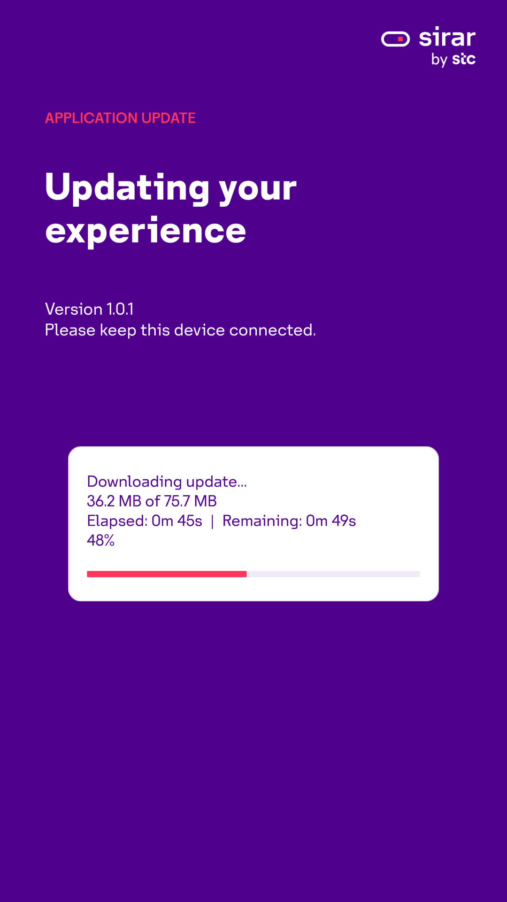

# Sirar • Cybersecurity Awareness

Two interactive Windows experiences. Inspect suspicious messages, protect a practice account, and learn through animated feedback.

## Download for Windows

**[Phishing Challenge — download ZIP](https://github.com/salah-del/Sirar/releases/latest/download/PhishingChallenge-windows-x64.zip)** · **[Account Security — download ZIP](https://github.com/salah-del/Sirar/releases/latest/download/AccountSecurity-windows-x64.zip)**

### Start in three steps

1. Download either application using its button above.
2. Right-click the ZIP → **Extract All**. Choose a writable folder, such as your user Downloads folder.
3. Open the extracted folder and run **PhishingChallenge.exe** or **AccountSecurity.exe**.

Keep the executable together with all its accompanying folders and DLLs. Unity and a GitHub account are not required. Do not run directly inside the ZIP.

## Choose your experience

| Phishing Challenge | Account Security |
| --- | --- |
| Inspect two similar addresses using a draggable magnifying glass. | Create a practice password and explore its strength. |
| Decide whether to share a password with an unexpected message. | Watch an illustrative guessing animation and respond to a new-device prompt. |
| Receive feedback, retry mistakes, and finish with practical advice. | Receive feedback, retry mistakes, and finish with practical advice. |

Designed for portrait touch displays, with mouse and keyboard support and responsive layout. Use practice information only; never enter a password you use elsewhere. The guessing sequence is an illustration, not an attack or a measured cracking benchmark.

## Updates inside the app

Starting with version 1.0.2, the app checks a small public update manifest about every **10 seconds** while online, including in the background, and checks again when it regains focus. A newer version opens the update screen automatically from any page after an active decision animation finishes. This is frequent polling, not instantaneous push delivery; network failures and hosting propagation can add delay.

Choose **Download update**. When a patch for your installed version is available, **only changed files are downloaded**. The screen shows the package size, downloaded/total megabytes, percentage, elapsed time and estimated time remaining. The app verifies the download and installed base files, closes, applies the changes, and restarts. Unchanged images, videos and runtime files are retained. Replaced or removed files are backed up for rollback if installation fails.

**One-time transition:** versions 1.0.0 and 1.0.1 only understand full update packages and check every five minutes at the home screen. Return home and restart once to trigger that older check promptly. They must receive version 1.0.2 once through their existing in-app updater before incremental downloads and faster detection become available. No manual uninstall is required. If no compatible patch exists for a future version, the app clearly labels a full package before download.

Downloads are checked against GitHub's published SHA-256 digest. Offline use of the learning scenarios remains available; failed checks retry with backoff. Choose **Later** to defer an offer for the current session. Keep the app folder writable and retain the complete extracted folder.

## Requirements and help

- Windows 10 or 11, 64-bit; compatible graphics drivers.
- Internet is needed for downloads and update checks, not the learning scenarios.
- These releases are not Authenticode-signed. Windows may display an unknown-publisher warning; verify the release source and checksum before running.
- If an update fails, read the displayed error and keep the existing app folder. You can also download the latest ZIP and extract it into a new folder.
- **[All releases and checksums](https://github.com/salah-del/Sirar/releases)** · **[Report a problem](https://github.com/salah-del/Sirar/issues)**

This repository distributes the Windows applications. It does not publish the Unity project or third-party asset sources. Branding and bundled assets remain subject to their respective owners' rights; dependency notices are included with the applications.

